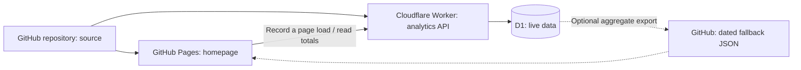

# Visitor analytics replacement

Design date: November 17, 2026.
Status: backend and homepage deployed; production counter verified.
See `../analytics/README.md` for the implemented counting contract.

Backend deployment: `https://weijue-visitors.weijuebu.workers.dev`.
The dedicated D1 counter started at `2026-11-17T15:18:20.000Z`.
Health, read-only totals, browser CORS preflight and both normal/direct local
network requests were verified. Independent mobile-network testing remains
outside the current verification coverage.

Verification: 11 backend tests and 14 frontend tests passed. In the deployed
homepage, a refresh issued only `GET /v1/totals` and left both numbers unchanged;
a subsequent page load added a view while retaining the same visitor count.
Desktop and 390px mobile layouts were checked. The published fallback is a
genuine API reading, not an imported or reconstructed legacy total.

## Problem and evidence

The homepage loads successfully, but its Busuanzi JSONP request returned HTTP
502 in the user's browser. Separate command-line requests also failed or timed
out. The browser therefore displayed its last successful reading: 21 estimated
visitors and 71 page views, recorded on November 16, 2026.

A 502 response identifies a gateway/upstream failure on the tested request
path. It does not establish whether the underlying cause is overload,
maintenance, or another network/backend problem. The provider's internal logs
are unavailable.

The existing dated fallback is useful and should remain. Replacing its date
without a successful response would misrepresent old data as current.

## Recommendation

Keep the website on GitHub Pages and put a small analytics API on Cloudflare
Workers, backed by D1. Store source code and optional aggregate snapshots in the
GitHub repository. Store live counters and deduplication records in D1.

GitHub Pages serves static files. A repository cannot accept anonymous website
writes as a database without a separate authenticated service. Do not embed a
GitHub token in the frontend or commit one change per visit.

This design avoids operating a virtual server while keeping the collector,
counting rules, database, and diagnostics in the user's own account. It still
depends on Cloudflare and on visitors being able to reach the collector.

The hosted alternative is GoatCounter. It offers a dashboard and a public JSON
counter, but its public counter can be cached for up to four hours. That delay
is less suitable for a homepage widget expected to reflect recent visits.

## Request flow

1. A browser loads the existing GitHub Pages homepage.
2. The frontend generates a random anonymous browser ID when local storage
   works, plus a new event ID for this page load.
3. `POST /v1/visit` records that page-load event and returns aggregate totals.
4. The Worker validates input, applies limits and writes transactionally to D1.
5. The refresh button calls `GET /v1/totals`; reading totals never adds a visit.
6. If the API fails, the frontend retains a dated successful reading and shows
   that live statistics are unavailable.

The frontend retries an uncertain POST only with its original event ID. It
does not generate a fresh counting event for each retry.

Use a custom API hostname if the user has a suitable domain. Otherwise test
the assigned Worker hostname on the user's usual desktop and mobile networks
before choosing it for production. Do not migrate on the strength of one
successful request.

## Counting contract

| Metric | Meaning |
| --- | --- |
| Visitors (estimated) | Distinct stored anonymous browser IDs since migration |
| Page views | Accepted distinct page-load event IDs since migration |
| Visitors today, optional | Distinct browser IDs on the configured calendar day |

A browser ID identifies a browser profile, not a person. Clearing storage,
private browsing and using a different device can create another ID. When
storage is unavailable, record page views without inventing a persistent
visitor identity. Publish that limitation with the metric description.

There is no fingerprinting. The application does not persist IP addresses,
full user agents, query strings, or individual browsing trails. Hash browser
IDs with a server-held HMAC secret before storage. Platform request processing
and logs are a separate layer; review their settings before deployment.

Keep aggregate counters, hashed visitor keys, and a short-lived event
deduplication table. Lifetime unique-browser counts require retaining the
hashed visitor keys for the life of that metric. Deleting those keys or
changing the HMAC secret changes the counting semantics.

Use database uniqueness constraints and atomic transactional updates rather
than reading a count into JavaScript and writing back an incremented value.
Expire event IDs after eight days; reject events older than the seven-day retry
window. The extra day buffers clock skew.
Treat client timestamps as untrusted input.

An origin allowlist, payload validation, event deduplication and request limits
reduce abuse. CORS and an origin header do not authenticate a human visitor.
The result remains an estimate, not an audited count of people.

## Widget design

Retain the existing typography, white background, blue accents and visitor
layout. Keep two main numbers: Visitors and Page views.

- Fresh response: a quiet blue status indicator and "Updated just now".
- Cached response: a neutral/amber indicator and "Live stats unavailable",
  followed by the actual saved date.
- No valid response or cache: display a dash, not zero.
- Refresh: read totals only; do not record another view.
- Optional later addition: a seven-day sparkline from real daily aggregates.

The current world map stays decorative. Geographic highlights or country
counts should only be added after collecting and verifying the relevant
aggregate data.

## Migration and retention

Start the new statistics on the actual production cutover date. Preserve the
old 21/71 reading with its timestamp in an archive, but do not add the old
estimated visitors to the new unique-browser count. The methods differ and
there is no reliable overlap data or record of visits missed during outages.

Optional GitHub backups contain only aggregate totals and their timestamps.
They are fallback display data, not a complete database recovery mechanism.
Database recovery requires an appropriate D1 export/backup as well. Do not
publish visitor keys, event IDs or secrets in the public repository.

## Cost and deployment

Cloudflare currently lists these free-plan allowances:

- Workers: 100,000 requests per day.
- D1: 5 million rows read and 100,000 rows written per day; 5 GB total storage.

These are platform limits, not a promise of 100,000 tracked visits per day.
Each event can require several database writes, and indexes affect usage.
Measure the deployed queries and storage. Start within the free plan and
require an explicit choice before introducing paid resources.

Deployment needs a Cloudflare account, a Worker, a D1 database and server-side
secrets. A custom domain is optional. GitHub hosts the source and website; it
does not need a visitor-accessible credential.

## Acceptance before switching production

Verify that one page load records one view; retries of the same event do not;
a returning browser does not become another lifetime visitor; and the refresh
button performs no writes. Test concurrent requests, unavailable storage,
upstream failure and recovery. Confirm that previews do not count.

Check API reachability on the user's normal network and a separate mobile
network. Check request limits and the actual D1 usage. Only then switch the
production frontend, retain an immediate rollback path, and verify the live
widget against database totals.

## Primary references

- GitHub Pages overview:
  <https://docs.github.com/en/pages/getting-started-with-github-pages/what-is-github-pages>
- Cloudflare Workers limits:
  <https://developers.cloudflare.com/workers/platform/limits/>
- D1 pricing and usage:
  <https://developers.cloudflare.com/d1/platform/pricing/>
- D1 transaction behavior:
  <https://developers.cloudflare.com/d1/worker-api/d1-database/>
- GoatCounter public visitor counter and caching:
  <https://www.goatcounter.com/help/visitor-counter>
